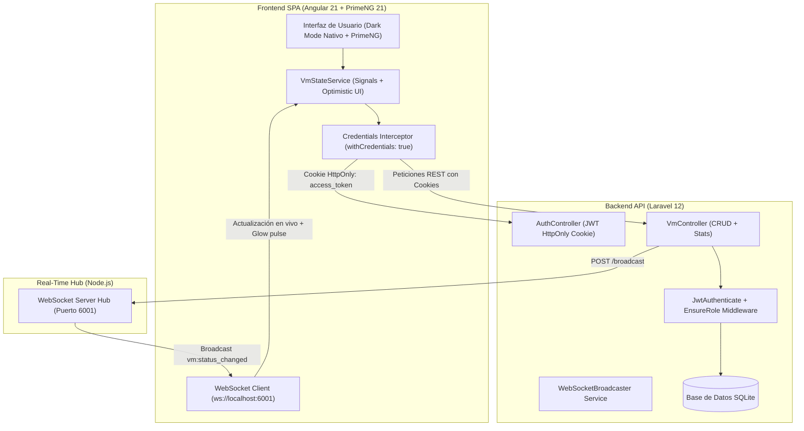

# IFX Networks — Plataforma de Gestión de Máquinas Virtuales (Cloud VM Manager)

Prueba técnica Full Stack enfocada en Frontend. Sistema desarrollado con **Angular 21 (SPA)**, **PrimeNG 21**, **Laravel 12 (API RESTful)** y **WebSockets en tiempo real**.

---

## Inicio Rápido

Para iniciar todos los servicios de forma simultánea en Windows:

```cmd
C:\wamp64\www\iniciar_todo.bat
```

Este script ejecuta en ventanas independientes:
1. **Backend API (Laravel)**: `http://localhost:8000`
2. **WebSocket Hub (Node.js)**: `ws://localhost:6001`
3. **Frontend SPA (Angular)**: `http://localhost:4200`

### Arranque manual paso a paso

Ejecución individual de cada servicio:

* **Backend:**
  ```bash
  cd ifx_vm_backend
  composer install
  php artisan migrate --seed
  php artisan serve --port=8000
  ```

* **WebSockets:**
  ```bash
  cd ifx_vm_backend/realtime
  npm install
  node server.js
  ```

* **Frontend:**
  ```bash
  cd ifx_vm_frontend
  npm install
  npm start
  ```

---

## Credenciales de Prueba

La base de datos incluye datos iniciales mediante seeders. La vista de inicio de sesión dispone de botones para carga rápida de credenciales:

| Rol | Correo | Contraseña | Permisos |
| :--- | :--- | :--- | :--- |
| **Administrador** | `admin@ifxcorp.com` | `Admin2026*!` | Acceso completo: creación, edición de recursos, cambio de estado y eliminación de VMs. |
| **Cliente** | `cliente@ifxcorp.com` | `Cliente2026*!` | Solo lectura: visualización de inventario, métricas y sincronización en vivo. Controles administrativos no presentes en el DOM. |

---

## Arquitectura del Sistema



---

## Aspectos Técnicos y Seguridad

### 1. Autenticación y Manejo de Sesión (Cookie HttpOnly)
* Para mitigar riesgos de vulnerabilidades XSS, el token JWT no se almacena en `localStorage`.
* El endpoint `POST /api/login` genera una cookie `Set-Cookie` con los atributos:
  * `HttpOnly = true`
  * `SameSite = Lax`
  * `Path = /`
* El cuerpo de la respuesta devuelve únicamente la información básica del usuario y su rol. El frontend incluye las credenciales automáticamente mediante `withCredentials: true`.

### 2. Actualización Optimista (Optimistic UI)
* La aplicación actualiza la interfaz de forma inmediata ante acciones de cambio de estado, edición o eliminación mediante **Angular Signals**.
* Se preserva una copia previa del estado. En caso de fallo en la petición HTTP, el sistema realiza una reversión automática (rollback) y emite una notificación al usuario.

### 3. Visualización de Métricas (Chart.js)
* Panel de control que calcula en tiempo real el consumo de recursos de las máquinas en estado `Activa`: suma de vCPU Cores, memoria RAM (GB) y almacenamiento asignado (GB).
* Gráfico de distribución porcentual según el sistema operativo configurado.

### 4. Sincronización en Tiempo Real (WebSockets)
* Los cambios de estado generados por administradores se propagan al servidor de eventos (`ws://localhost:6001`) y se distribuyen a los clientes conectados.
* El elemento actualizado refleja el cambio instantáneamente en pantalla con una indicación visual de pulso.

### 5. Estructura Modular del Frontend
* Capas de servicio desacopladas:
  * `RequestGenericoService`: Abstracción para operaciones HTTP y control de errores.
  * `VmModelService` / `AuthModelService`: Servicios de modelo encargados del mapeo y normalización de datos (`transformRequest`, `transformResponse`).
  * `VmStateService`: Manejo del estado global de la aplicación.
* Integración de componentes **PrimeNG 21**: vista en tabla con paginación y ordenamiento (`p-table`), formularios modales (`p-dialog`), selectores (`p-select`), campos numéricos (`p-inputNumber`), etiquetas de estado (`p-tag`) y diálogos de confirmación (`p-confirmDialog`).

---

## Bitácora de Desarrollo con IA

Sección elaborada conforme a los requerimientos de la prueba técnica:

### 1. Herramientas utilizadas
Asistente de IA integrado en el entorno de desarrollo como soporte en la generación de código base.

### 2. Delegación de tareas y criterio técnico
* **Generación automatizada:**
  * Estructura inicial de migraciones y modelos Eloquent en Laravel.
  * Plantillas base para formularios reactivos y contratos de interfaces TypeScript.
  * Esquema inicial de estilos SCSS y scripts de ejecución por lotes.
* **Criterio e intervención técnica:**
  * **Configuración de seguridad:** Implementación manual del flujo de autenticación mediante cookies con atributos `HttpOnly` y `SameSite=Lax`, evitando el almacenamiento de tokens en el navegador.
  * **Gestión de estado:** Implementación de la reactividad basada en Signals y la lógica de reversión (rollback) para evitar bloqueos con indicadores de carga.
  * **Control de acceso en el DOM:** Restricción estricta de elementos administrativos mediante directivas `*ngIf` según el rol autenticado.
  * **Organización modular:** Separación de servicios en capas reutilizables e integración de componentes PrimeNG.

### 3. Prompts de referencia
* **Seguridad y autenticación:**  
  > *"Configurar en Laravel un flujo de autenticación donde el token JWT viaje en una cookie HttpOnly con SameSite=Lax y el endpoint de login retorne solo los datos del usuario. Configurar Angular con withCredentials: true y cabeceras CORS compatibles."*

* **Gestión de estado y Optimistic UI:**  
  > *"Implementar un servicio en Angular con Signals para manejar actualización optimista al crear, modificar o eliminar registros, recalculando dinámicamente el uso de recursos y aplicando rollback ante errores de API."*
